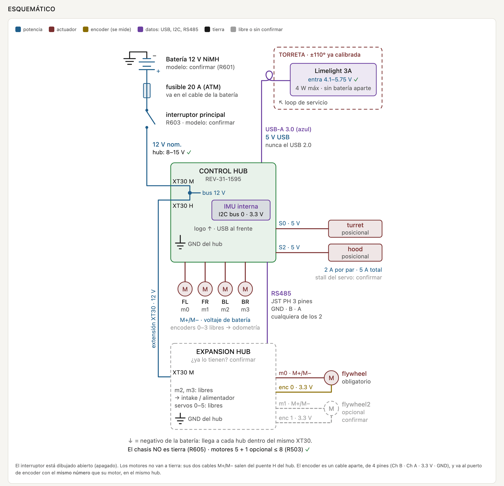

# ftc-biobuzz

Código del robot FTC para la temporada 2026-2027, **BIOBUZZ**. Robot con torreta que
apunta sola a los CELLS del HIVE usando un Limelight 3A montado sobre la torreta.
El giro, el ángulo del hood y la velocidad del flywheel se ajustan solos.

Base: FtcRobotController SDK **12.0**, Java. Todo el código propio vive en
`robot/TeamCode/src/main/java/org/firstinspires/ftc/teamcode/`.

## Cómo está armado

| Archivo | Qué hace |
|---|---|
| `Config.java` | **Todos** los números ajustables. Lo marcado MEDIR o CALIBRAR es de relleno. |
| `vision/Cell.java` | Los 4 CELLS del campo y sus tags: rojo 30 a 37, azul 38 a 45. |
| `vision/ClusterSolver.java` | De tags sueltos saca el ángulo al centro del CELL, aunque haya tags tapados. |
| `vision/CellVision.java` | Lee el Limelight, filtra por alianza, calcula distancia. |
| `subsystems/Turret.java` | Servo posicional con compensación de retraso de cámara y de giro del chasis. |
| `subsystems/Shooter.java` | Flywheel con control de velocidad y hood, por tabla de distancia. |
| `subsystems/MecanumDrive.java` | Chasis mecanum básico. |
| `opmodes/TeleOpRed`, `TeleOpBlue` | TeleOp de competencia. |
| `opmodes/TuneTurret`, `TuneShooter` | Calibración. |
| `docs/cableado.html` | Hoja de cableado: cada puerto de cada hub y por qué. |

### Por qué no se apunta al promedio de los tags

Cada CELL tiene debajo una fila de 4 AprilTags y el centro de la fila coincide con el
centro de la abertura. El Limelight no conoce los "clusters" del SDK, ve tags sueltos.
Si se promedian los visibles y dos están tapados, el tiro se va unas 4.5 in de lado.
`ClusterSolver` ajusta una recta con la posición conocida de cada tag en la fila y lee
el ángulo en el centro. En simulación el peor error queda abajo de 1.5 in.

### Por qué la torreta no oscila

La foto llega con 30 a 80 ms de retraso y el servo no reporta posición. `Turret` lleva
un historial de hacia dónde apuntaba y suma el `tx` al ángulo que había **cuando se tomó
la foto**. Además guarda el rumbo del objetivo en el campo con el IMU, así que cuando el
driver gira el chasis la torreta contragira sin esperar otra foto.

## Cableado



La hoja completa está en [docs/cableado.html](docs/cableado.html). Descárgala y ábrela en el
navegador: trae cada puerto con su porqué, las dudas no obvias y la lista de antes de
energizar. [docs/cableado.png](docs/cableado.png) es la misma hoja como imagen, para verla
desde GitHub o el teléfono.

Nada de esto se ha medido en el robot físico. Sale de la documentación de REV, Limelight y
FIRST, del manual y del código. Lo marcado "confirmar contra la pieza" sigue pendiente.

Con 5 o 6 motores el robot **necesita un Expansion Hub**: el Control Hub solo tiene 4 puertos
de motor, y sin él el TeleOp truena al dar INIT.

## Configuración del robot en la Driver Station

Los nombres distinguen mayúsculas. Obligatorio significa que el código usa
`hardwareMap.get` y el OpMode truena si falta.

| Hub | Puerto | Nombre | Tipo | |
|---|---|---|---|---|
| Control Hub | Motor 0 | `frontLeft` | modelo del motor | obligatorio |
| Control Hub | Motor 1 | `frontRight` | modelo del motor | obligatorio |
| Control Hub | Motor 2 | `backLeft` | modelo del motor | obligatorio |
| Control Hub | Motor 3 | `backRight` | modelo del motor | obligatorio |
| Control Hub | Servo 0 | `turret` | Servo, nunca Continuous Rotation | obligatorio |
| Control Hub | Servo 2 | `hood` | Servo | obligatorio |
| Control Hub | I2C bus 0 | `imu` | viene configurada sola | opcional |
| Control Hub | USB-A 3.0, el azul | `limelight` | "Ethernet Device" al dar Scan, renombrarlo | obligatorio |
| Expansion Hub 2 | Motor 0 + encoder 0 | `flywheel` | modelo del motor, con cable de encoder | obligatorio |
| Expansion Hub 2 | Motor 1 + encoder 1 | `flywheel2` | mismo modelo que `flywheel` | opcional |

La torreta y el hood van en los servos 0 y 2, no 0 y 1: cada par de puertos de servo
comparte 2 A, y así un servo trabado no tumba al otro.

## Pipeline del Limelight

En la interfaz web del Limelight, pipeline **0**:

- Tipo: Fiducial Markers / AprilTag, familia **36h11**
- Tamaño del marcador: **82.5 mm**
- Sin filtro de IDs, el código filtra por alianza
- "Full 3D" activado si se quiere comparar la distancia 3D
- Exposición baja y resolución media: importa más la velocidad que el detalle

## Orden de calibración

1. **Tune: Torreta**, con el USB del Limelight desconectado: este OpMode no respeta los límites
   en grados y puede jalar el cable. Sacar `SERVO_CENTER`, `DEG_PER_SERVO_UNIT`,
   `SERVO_INVERTED` y los límites.
2. Medir con cinta `CAMERA_HEIGHT_IN`, `CAMERA_PITCH_DEG` y `TAG_HEIGHT_IN`.
3. **Tune: Tiro**. Comparar las dos distancias contra la cinta, elegir `USE_3D_DISTANCE`
   y llenar `SHOT_TABLE` en cinco o seis distancias.
4. Medir la velocidad real de la torreta y ponerla en `MAX_SPEED_DEG_S`. Si oscila, bajar
   ese número o `AIM_SMOOTHING`.
5. Ajustar el PIDF del flywheel viendo qué tan rápido recupera RPM después de un tiro.

## Controles del TeleOp

| Control | Acción |
|---|---|
| Gamepad 1, sticks | Chasis. Gatillo derecho = lento |
| A | Auto-apuntado sí/no. Arranca en sí |
| Bumper derecho | Flywheel sí/no |
| Y | Torreta al frente |
| Dpad izq/der, o stick derecho del gamepad 2 | Torreta a mano |

El control vibra cuando la torreta está fija en el CELL y el flywheel ya alcanzó sus RPM.

## Probar sin robot

```bash
./sim/run.sh
```

Compila TeamCode contra los JAR reales del SDK y corre una simulación: solver con tags
tapados y ruido, y la torreta en lazo cerrado con retraso de cámara, servo más lento o
más rápido que el modelo y el chasis girando a 90 grados por segundo.

## Compilar e instalar

Abrir la carpeta `robot/` en Android Studio y correr `TeamCode` sobre el Control Hub.

## Pendiente

- Alimentador e intake: el código avisa cuándo está listo para tirar, pero todavía no
  hay mecanismo que meta el POLLEN al flywheel.
- Autónomo.
- Todos los valores MEDIR y CALIBRAR de `Config.java`.

## Otros

`rampa/` tiene un render en VTK de una rampa, independiente del código del robot.
